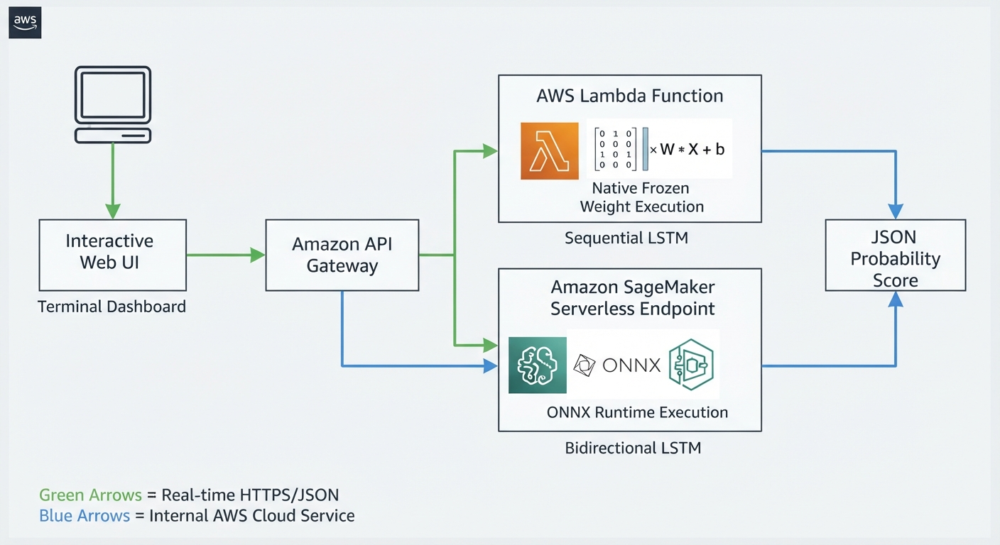

# **US Business Cycle Predictive Terminal**

A high-performance, full-stack MLOps forecasting platform that transitions macroeconomic contraction models out of isolated research environments into a zero-maintenance, serverless cloud cluster.
The architecture features an interactive static frontend web terminal communicating via **Amazon API Gateway** to a hybrid inference engine: a custom, native forward-pass sequential LSTM running on **AWS Lambda** alongside a deep Bidirectional LSTM running inside an **Amazon SageMaker Serverless Endpoint**.

#🏗️ **System Architecture Overview**

#📈 **The Engineering Journey: Research to MLOps Production**

1.   **Exploratory Phase (/original_research)**

*   **Baseline Benchmarking:** Evaluated classic and structural models (Logistic Regression, Random Forest, XGBoost, and Standard RNNs) against 45 years of historical US business cycle data.

*   **The Architecture Pivot:** Determined that Long Short-Term Memory (LSTM) networks provided the most desirable sequence processing for lagging macroeconomic indicators due to their internal gate structures preventing vanishing gradients over long lookback windows.

2.   **Production Scalability Phase (/production_models)**

To prevent global state conflicts, memory bloat, and deployment friction, the monolithic notebook was split into clean sequential pipelines:

*   **01_sequential_lstm.ipynb:** Dedicated to training the fast-inference baseline network. To eliminate container cold starts and compute expenses, the final trained weight coefficients and bias arrays were extracted as frozen mathematical constants, executing forward-pass matrix math natively in vanilla Python.

*   **02_bidirectional_lstm.ipynb:** Built to capture both forward and backward temporal dependencies in complex stagflationary patterns. The complex architecture is serialized into an **ONNX (Open Neural Network Exchange)** layer format for high-efficiency, runtime-agnostic execution.

#🛠️ **Repository Directory Structure**

US_Recession_Capstone/
├── data/
    └── US_Recession.csv                            # Sourced via Kaggle https://www.kaggle.com/datasets/shubhaanshkumar/us-recession-dataset/data (for research phase)
    └── fred_funds.csv                              # Federal FUNDS rate downloaded from Federal Reserver bank https://fred.stlouisfed.org/
    └── fred_gdp.csv                                # Federal quarterly GDP downloaded from Federal Reserver bank https://fred.stlouisfed.org/
    └── fred_inflation.csv                          # Federal inflation rate downloaded from Federal Reserver bank https://fred.stlouisfed.org/
    └── fred_unrate.csv                             # Federal unemployment rate downloaded from Federal Reserver bank https://fred.stlouisfed.org/
    └── fred_recession.csv                          # Federal recession history downloaded from Federal Reserver bank https://fred.stlouisfed.org/
    └── data_pipeline/
        └── harvest_and_sync.ipynb                  # codes to download new Federal FUNDRATE, GDP, inflation, unemployment data into aws S3 bucket
│
├── .github/
    └── workflows/
        └── data_refresh_ci.yml                     # weekly job to update new data from Federal Reserver Bank
│
├── images/
    ├── classical_models_comparison_chart.png       # Evaluation matrix charts
    └── coefficients_analysis_chart.png             # Visualization of features impact on US Recession prediction
│
├── original_research/
    └── US_Recession.ipynb                          # Monolithic EDA, baseline testing, and prototyping
    └── research_readme.md                          # Research document analyzing the results from US_Recession.ipynb
│
├── production_models/
    ├── 01_sequential_lstm.ipynb                    # Sequential training & frozen weight coefficient extraction
    └── 02_bidirectional_lstm.ipynb                 # Deep Bidirectional modeling & ONNX compilation export
│
├── aws_infrastructure/
    ├── lambda_handler.py                           # Lightweight, zero-cold-start native inference node
    └── sagemaker_inference.py                      # Runtime container initialization for SageMaker
│
├── client/
    ├── nber_terminal.html                          # Interface terminal window with absolute-offset layout
    └── app.js                                      # Real-time state management and API Gateway ingestion

└── README.md                                       # Core system documentation

#🚀 **Key Engineering & MLOps Implementations**

*   **Asynchronous Data Alignment Tier:** Solved structural frequency mismatches between monthly metrics (Unemployment, CPI, Fed Funds Rate) and quarterly metrics (GDP) using forward-fill upsampling algorithms to prevent temporal array dimension crashes during tensor injection.

*   **Cost Optimization to $0.00:** Configured the Amazon SageMaker Serverless Endpoint configuration (MemorySize: 1024MB, MaxConcurrency: 3) with disabled Provisioned Concurrency. Combined with the native Lambda mathematical weights execution, the entire ecosystem operates completely inside the AWS Free Tier, incurring zero cost when idle.

*   **Gradient Convergence Stabilization:** Mitigated severe dataset class imbalances inherent to short macroeconomic contraction cycles by enforcing custom threshold-proximity masking layers and passing weighted loss penalties to stabilize backpropagation gradients.

*   **Simultaneous Multi-Variable Policy Shocks:** Developed a client-side slider ingestion matrix that transforms user selections into clean 3D tensor sequences, enabling real-time multi-variable economic forecasting simulation.

*   **Zero-Cache DOM Redrawing:** Eliminated browser-cache layout errors by bypassing heavy interface frameworks, utilizing vanilla JavaScript DOM node mutations to dynamically map calendar grids across multi-horizon timelines.

#💻 **Tech Stack & Tooling**

*   **Core Machine Learning:** Python, Keras 3, TensorFlow, ONNX Runtime, Scikit-Learn, Pandas, NumPy, SciPy

*   **Cloud & MLOps Infrastructure:** AWS SageMaker Serverless, AWS Lambda, Amazon API Gateway, Amazon S3, AWS CloudWatch, GitHub Actions

*   **Frontend Interface:** Vanilla JavaScript (ES6+), HTML5, CSS3 (Absolute-Offset Configurations)

*   **Backend Enterprise Foundations:** Java, Spring Boot, Git, Docker